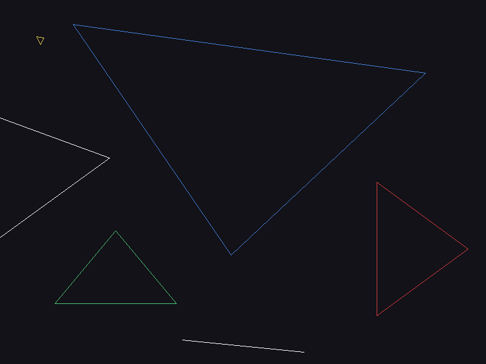
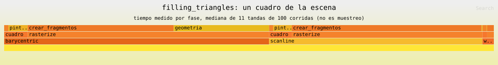

# Filling triangles

Rasterizador por software en Rust. La funcion `triangle` puede dibujar el
contorno de un triangulo o rellenar su interior con dos algoritmos distintos:
coordenadas baricentricas y lineas horizontales.


## Como se corre

```bash
cargo run --release                             # ventana: 1 contorno, 2 baricentrico, 3 scanline, Esc salir
cargo run --release -- --compare-fills          # compara las posiciones que genera cada relleno
cargo run --release -- --benchmark-triangles    # mide la generacion de fragmentos, sin ventana
cargo run --release -- --profile-phases         # reparte el tiempo del cuadro entre sus fases
cargo run --release -- --profile-flamegraph     # escribe docs/perfil/perfil.folded y flamegraph.svg
cargo run --release -- --dump-images            # guarda out/<modo>.ppm
cargo test                                      # pruebas unitarias y de integracion
```

## Modos de dibujo

El modo se pasa a `rasterize` y no cambia ni el ensamblaje de primitivas ni el
procesamiento de fragmentos:

```rust
#[derive(Clone, Copy)]
pub enum TriangleMode {
    Wireframe,
    FilledBarycentric,
    FilledScanline,
}
```

| Modo | Imagen |
| --- | --- |
| `Wireframe` |  |
| `FilledBarycentric` |  |
| `FilledScanline` |  |

La escena tiene a proposito un triangulo chico, uno grande, uno con arista
horizontal, uno con arista vertical, uno que se sale del framebuffer y tres
vertices colineales. El caso colineal se ve solo en el modo contorno: el
contorno de un triangulo de area cero es un segmento, mientras que los dos
rellenos lo tratan como caso degenerado y no generan ningun fragmento.

Acercamiento al triangulo mas chico (24x24 pixeles ampliados 12 veces), donde se
nota que lo que decide el relleno es el centro de cada pixel:


## Algoritmo 1: coordenadas baricentricas

1. Se calcula el rectangulo mas chico que contiene a los tres vertices, medido
   en pixeles enteros ([`bounds.rs`](src/bounds.rs)).
2. Para cada pixel de ese rectangulo se evalua su centro `(x + 0.5, y + 0.5)`.
3. Se calculan las tres coordenadas baricentricas de ese centro. Si las tres son
   positivas o cero, se genera un fragmento.

Los pesos se obtienen dividiendo cada subarea con signo entre el area total, asi
que **el signo del orden de los vertices se cancela**: invertir el orden da
exactamente el mismo relleno. Si el area es cero, `barycentric` devuelve `None`
y el triangulo se descarta en lugar de dividir entre cero.

## Algoritmo 2: lineas horizontales

Se avanza una fila a la vez. En vez de recorrer la fila pixel por pixel, cada
arista se despeja como una desigualdad en `x` sobre la recta `y + 0.5`:

* la arista que sube acota el tramo por la izquierda,
* la arista que baja lo acota por la derecha,
* una arista horizontal no acota nada: o la fila entera esta adentro, o la fila
  entera esta afuera.

El tramo interior es la interseccion de las tres restricciones, y se generan los
pixeles cuyo centro cae dentro de ese tramo. Tratar la arista horizontal como un
caso sin cruce (en vez de como dos cruces) es lo que evita huecos y fragmentos
duplicados cuando una arista o un vertice caen justo sobre una fila.

## Comprobacion de resultados

Las reglas son las mismas en los dos algoritmos: se muestrea el centro del pixel
y un centro que cae exactamente sobre una arista cuenta como interior. Con eso
los dos rellenos generan **exactamente las mismas posiciones**, no solo imagenes
parecidas (`--compare-fills`):

```
caso                    baricentr   scanline     solo bar    solo scan
pequeno                        75         75            0            0
grande                      99810      99810            0            0
orden_inverso               99810      99810            0            0
arista_horizontal           12000      12000            0            0
arista_vertical             16510      16510            0            0
parcialmente_afuera         36100      36100            0            0
colineales                      0          0            0            0
```

Ademas de los casos del laboratorio, las pruebas de integracion comparan los dos
rellenos con triangulos generados al azar (grandes, diminutos y parcialmente
fuera de la imagen) y verifican que las imagenes pintadas sean identicas byte a
byte.

### La diferencia que si aparecio

Con triangulos grandes al azar aparecia **un pixel de diferencia**: el centro
caia practicamente sobre una arista y, con coordenadas de varios cientos de
pixeles, el redondeo de `f32` dejaba ese centro adentro para un algoritmo y
afuera para el otro. El relleno baricentrico decide con el signo de un producto
cruz y el relleno por filas decide con una division, asi que los dos redondean
distinto. La solucion fue evaluar las pruebas de interior en `f64` aunque las
posiciones sigan siendo `f32`.

El triangulo que se sale del framebuffer no se recorta durante la
rasterizacion: los dos algoritmos generan tambien los fragmentos con coordenadas
negativas y el recorte ocurre al pintar, en `Framebuffer::point`. Asi las dos
implementaciones se pueden comparar fragmento a fragmento sin que el borde de la
imagen esconda diferencias.

## Mediciones

`cargo run --release -- --benchmark-triangles`. Se mide solo `rasterize`: no
entran la actualizacion de la textura, ni el dibujo de la ventana, ni la espera
entre cuadros. Cada modo corre 100 rasterizaciones por tanda, 11 tandas, y se
reporta la mediana; `std::hint::black_box` evita que el optimizador borre el
trabajo medido. La salida completa esta en
[docs/mediciones.txt](docs/mediciones.txt).

| Modo | Fragmentos | Por corrida | ns/fragmento |
| --- | ---: | ---: | ---: |
| `wireframe` | 3 484 | 37.7 us | 10.8 |
| `barycentric` | 164 495 | 1.286 ms | 7.8 |
| `scanline` | 164 495 | 1.025 ms | 6.2 |

Los dos rellenos producen la misma cantidad de fragmentos, asi que la
comparacion es justa: ninguno parece rapido por omitir parte del triangulo.

Por caso, la ventaja del scanline depende de cuanto del rectangulo contenedor es
interior:

| Caso | Fragmentos | Baricentrico | Scanline | Relacion |
| --- | ---: | ---: | ---: | ---: |
| `pequeno` | 75 | 375 ns | 230 ns | 1.6x |
| `grande` | 99 810 | 875.3 us | 736.2 us | 1.2x |
| `arista_horizontal` | 12 000 | 46.1 us | 22.8 us | 2.0x |
| `arista_vertical` | 16 510 | 63.8 us | 33.4 us | 1.9x |
| `parcialmente_afuera` | 36 100 | 140.9 us | 56.9 us | 2.5x |

El triangulo `grande` cubre casi la mitad de su rectangulo contenedor y ahi la
diferencia es chica, porque casi todo el tiempo se va en escribir fragmentos. En
los triangulos delgados o muy inclinados, el relleno baricentrico prueba muchos
centros que termina descartando y el scanline ni los visita.

### Cuidado con la maquina

La primera tanda de mediciones se tomo con una compilacion corriendo en segundo
plano y dio 3.57 ms y 2.69 ms por corrida: **casi tres veces mas lento** que los
numeros de arriba, con el mismo binario. La relacion entre los dos algoritmos se
mantuvo, pero los tiempos absolutos no significan nada sin decir en que
condiciones se midieron. Por eso se reporta la mediana de 11 tandas y
`docs/mediciones.txt` anota el equipo y el estado de la maquina.

## Donde se va el tiempo

`cargo flamegraph` esta instalado, pero en Windows usa `blondie` y necesita una
terminal de administrador; sin eso falla con `NotAnAdmin`. Con permisos de
administrador el comando del laboratorio funciona tal cual, y el modo
`--benchmark-triangles` existe justamente para eso (rasteriza muchas veces y
termina sin abrir la ventana):

```bash
cargo flamegraph --release -- --benchmark-triangles
```

Para no quedarse sin perfil, el programa genera el suyo:

```bash
cargo run --release -- --profile-flamegraph
```

Eso escribe [`docs/perfil/perfil.folded`](docs/perfil/perfil.folded) (pilas
plegadas, el mismo formato que consumen los visores de flamegraph) y lo dibuja
con `inferno` en [`docs/perfil/flamegraph.svg`](docs/perfil/flamegraph.svg):



**No es un perfilador de muestreo.** En vez de interrumpir el programa muchas
veces por segundo, se mide la misma geometria contando fragmentos sin crearlos
([`profile.rs`](src/profile.rs)) y se le resta a la rasterizacion completa.
Poner un reloj dentro del ciclo de pixeles costaria mas que el trabajo que se
quiere medir, y el ancho de cada bloque sigue siendo tiempo medido. La
contrapartida es que la resta supone que las fases no se solapan: en el relleno
baricentrico la geometria y el guardado se intercalan en el mismo ciclo, asi que
parte de su costo de guardado queda contado dentro de la geometria.

| Modo | Geometria | Crear fragmentos | Limpiar | Pintar | Cuadro |
| --- | ---: | ---: | ---: | ---: | ---: |
| `wireframe` | 0.1 us | 36.3 us | 24.2 us | 2.3 us | 62.9 us |
| `barycentric` | 506.7 us | 811.1 us | 23.7 us | 104.7 us | 1.446 ms |
| `scanline` | 4.7 us | 1045.1 us | 22.6 us | 100.3 us | 1.173 ms |

Lo que se ve en el perfil:

* En el relleno baricentrico, el 38 % del tiempo es geometria: tres productos
  cruz y tres divisiones **por cada centro del rectangulo contenedor**, se use o
  no el resultado.
* En el relleno por filas la geometria practicamente no existe (4.7 us contra
  506 us): se resuelve una vez por fila y el largo del tramo sale de una resta.
  Todo su tiempo es crear y guardar fragmentos.
* Limpiar el framebuffer cuesta lo mismo en los tres modos (~23 us, es la imagen
  completa) y pintar los fragmentos cuesta lo mismo en los dos rellenos, que
  generan la misma cantidad.
* Como el cuello de botella es la memoria y no el calculo, reservar el `Vec` de
  fragmentos antes de rasterizar bajo la escena de 1.639 ms a 1.286 ms en
  baricentrico (-20 %) y de 1.402 ms a 1.028 ms en scanline (-27 %), medido con
  el mismo binario en el mismo rato.

## Decisiones que vale la pena mirar

* El contorno ordena los extremos de cada linea antes de recorrerla
  ([`line.rs`](src/line.rs)): Bresenham rompe los empates siempre hacia el mismo
  lado, asi que sin eso el contorno de un triangulo cambiaba segun el orden de
  sus vertices.
* El rectangulo contenedor se calcula en pixeles enteros con `ceil(min - 0.5)` y
  `floor(max - 0.5)`, que es exactamente el rango de pixeles cuyo centro puede
  caer adentro ([`bounds.rs`](src/bounds.rs)).
* Un triangulo mas chico que un pixel puede no contener ningun centro: ahi
  `pixel_bounds` devuelve `None` y no se genera nada, sin casos especiales en
  los rellenos.
* El relleno baricentrico descarta el caso degenerado **antes** de reservar
  memoria: el area puede ser cero y el rectangulo contenedor enorme.

## Estructura

| Archivo | Que hace |
| --- | --- |
| [`src/framebuffer.rs`](src/framebuffer.rs) | pixeles, limpieza, recorte y exportacion a PPM |
| [`src/line.rs`](src/line.rs) | lineas con Bresenham (modo contorno) |
| [`src/barycentric.rs`](src/barycentric.rs) | coordenadas baricentricas y prueba de interior |
| [`src/bounds.rs`](src/bounds.rs) | rectangulo contenedor en pixeles enteros |
| [`src/triangle.rs`](src/triangle.rs) | `TriangleMode` y los tres algoritmos |
| [`src/render.rs`](src/render.rs) | ensamblaje de primitivas, `rasterize` y fragmentos |
| [`src/scene.rs`](src/scene.rs) | los triangulos de prueba y la escena de la ventana |
| [`src/compare.rs`](src/compare.rs) | comparacion de posiciones entre los dos rellenos |
| [`src/bench.rs`](src/bench.rs) | medicion con mediana y `black_box` |
| [`src/profile.rs`](src/profile.rs) | fases del cuadro y pilas plegadas para el flamegraph |
| [`tests/rellenos_equivalentes.rs`](tests/rellenos_equivalentes.rs) | los dos rellenos contra los casos del laboratorio y al azar |
